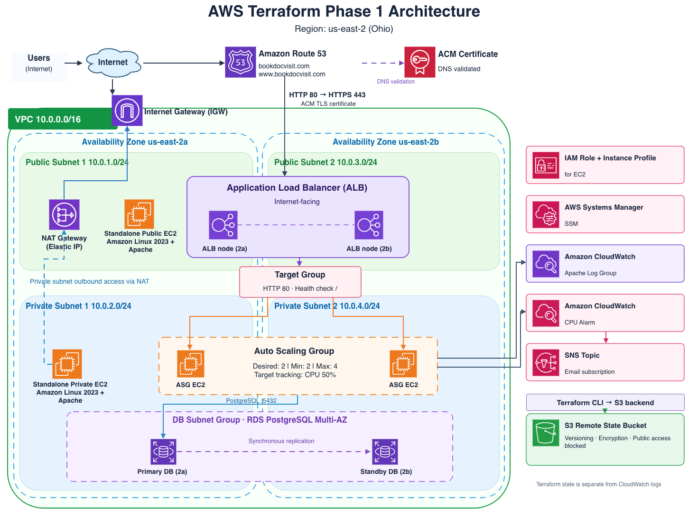

# AWS Infrastructure with Terraform — Phase 1

An end-to-end AWS infrastructure lab built first through the **AWS Management Console** and then recreated using **Terraform**. The repository includes both a **non-modular** implementation and a **modular** implementation to demonstrate infrastructure as code, networking, availability, security, monitoring, DNS, HTTPS, and remote state management.

**AWS Region:** `us-east-2` (Ohio)  
**Services:** VPC, EC2, ALB, Auto Scaling, RDS PostgreSQL, IAM, Systems Manager, CloudWatch, SNS, Route 53, ACM, and S3.

## Architecture Diagram

## Architecture Diagram

The following diagram illustrates the AWS infrastructure deployed using Terraform, including VPC networking across two Availability Zones, an Application Load Balancer, Auto Scaling Group, EC2 instances, RDS PostgreSQL Multi-AZ, IAM, Systems Manager, CloudWatch, Route 53, ACM, and S3 remote state management.



[View Editable Architecture Diagram (draw.io)](diagrams/Architecture.drawio)

### Architecture Overview

- **Network and routing:** The VPC (`10.0.0.0/16`) spans `us-east-2a` and `us-east-2b`, each with a public and private subnet. An Internet Gateway provides internet connectivity for the public subnets. A NAT Gateway with an Elastic IP in public subnet 1 provides outbound internet access for instances in private subnets without assigning them public IPs.
- **Load balancing and compute:** One internet-facing **Application Load Balancer (ALB)** spans **both public subnets**, terminates HTTPS using an ACM certificate, and forwards HTTP traffic on port `80` through a target group to an **Auto Scaling Group (ASG)** across the two private subnets. The ASG starts with two instances and scales toward a 50% average CPU target. Two other EC2 instances (one public, one private) are **standalone lab instances**, not ASG members.
- **Database:** Amazon **RDS PostgreSQL** uses a DB subnet group covering both private subnets. **Multi-AZ** provides a primary database and a standby in another Availability Zone; the standby is for failover, not a separate application read endpoint. Its security group accepts PostgreSQL (`5432`) connections from the ASG security group. The master password is managed in **AWS Secrets Manager**.
- **IAM and Systems Manager:** An **EC2 IAM role** and **instance profile** let EC2 use Systems Manager and publish CloudWatch data with temporary role credentials rather than embedded access keys. **Systems Manager Run Command** installs and configures the CloudWatch Agent using the agent configuration stored in **SSM Parameter Store**.
- **Monitoring and alerts:** The **CloudWatch Agent** forwards Apache logs to a **CloudWatch Logs log group**. A **CloudWatch CPU alarm** sends notifications to an **SNS topic**, which sends emails once the recipient confirms the subscription. These monitoring services are AWS-managed services outside the VPC, not EC2 instances inside a subnet.
- **DNS and HTTPS:** **Route 53** hosts DNS for the application domain and points the apex and `www` records at the ALB. **ACM** validates domain ownership through DNS CNAME records and supplies the certificate used by the ALB HTTPS listener. HTTP requests on port `80` are redirected to HTTPS `443`.
- **Terraform state:** A separate **S3 remote-state bucket** stores Terraform state, with encryption, versioning, public access blocking, and state locking. S3 is **not** in the application request path: Terraform uses it to track the deployed resources.

> The diagram is a conceptual view of one ALB spanning two subnets, not two separate ALBs. The exact resource properties and dependencies are defined in the Terraform configuration.

---

## Prerequisites

Before deploying either version, ensure you have:

- An AWS account with permissions to create the required resources.
- **AWS CLI** and **Terraform** installed.

- A registered domain name you control, for Route 53 and ACM.
- An email address to receive CloudWatch alerts through Amazon SNS.
- An understanding that the deployment creates **billable AWS resources**.

### Install Terraform and AWS CLI on macOS

Install the command-line tools before creating the AWS CLI profile. The commands below run in the **macOS Terminal**.

**1. Install Homebrew (if not already installed)**

Homebrew is the package manager used below for Terraform. See the [official Homebrew installation instructions](https://brew.sh/) if the `brew` command is unavailable.

```bash
brew --version
```

**2. Install Terraform using HashiCorp's Homebrew tap**

```bash
brew tap hashicorp/tap
brew install hashicorp/tap/terraform
terraform -version
```

The last command verifies that Terraform is installed. See [HashiCorp's Terraform installation guide](https://developer.hashicorp.com/terraform/install).

**3. Install AWS CLI v2 using the official macOS installer**

```bash
curl "https://awscli.amazonaws.com/AWSCLIV2.pkg" -o "AWSCLIV2.pkg"
sudo installer -pkg ./AWSCLIV2.pkg -target /
aws --version
```

The last command verifies that AWS CLI is installed. Alternatively, download and open the `.pkg` from [AWS's official CLI installation guide](https://docs.aws.amazon.com/cli/latest/userguide/getting-started-install.html). If `aws` is not found, open a new Terminal window and try again.

Once both tools are installed, create the IAM user and configure its named AWS CLI profile below.

### Create the Terraform IAM user and AWS CLI credentials

For this learning lab we used a dedicated IAM user named `phase1-terraform` with the `AdministratorAccess` policy. **This grants broad permissions and is not recommended for production**; prefer IAM Identity Center / temporary credentials and least-privilege access for real deployments.

1. Sign in to the AWS Console with an identity permitted to manage IAM, then open **IAM → Users → Create user**.
2. Set **User name** to `phase1-terraform`. Console sign-in access is not required for a CLI-only user.
3. On the permissions step, select **Attach policies directly**, search for **`AdministratorAccess`**, and select it (lab only).
4. Finish creating the user. Open **IAM → Users → phase1-terraform → Security credentials**.
5. Under **Access keys**, click **Create access key**; select the **Command Line Interface (CLI)** use case if prompted, acknowledge the security recommendation, and create the key.
6. Copy or securely download the **Access Key ID** and **Secret Access Key**. AWS displays the secret key only at creation time. **Never commit either key to GitHub.**
7. On your computer, create a named CLI profile:

   ```bash
   aws configure --profile phase1-terraform
   ```

   Enter the access key ID, secret access key, default region `us-east-2`, and output format `json`.
8. Verify the profile:

   ```bash
   aws sts get-caller-identity --profile phase1-terraform
   ```

   The response identifies the AWS account and IAM principal used to sign AWS API requests. Ensure your Terraform AWS provider uses the same profile and region.

> If your files use a different AWS profile or region, update those settings consistently. The examples below assume `phase1-terraform` and `us-east-2`.

## Option 1: Deploy the Non-Modular Terraform Version

The non-modular implementation declares infrastructure resources directly in Terraform configuration files.

### 1. Configure the domain

In the non-modular Terraform files, replace the example domain wherever it is used:

- **Route 53 hosted zone:** Replace `example.com` with your registered domain.
- **Route 53 alias records:** Update the root and `www` DNS names for your domain.
- **ACM certificate:** Replace `example.com` and `www.example.com` with your domain and `www` subdomain.

After creating the hosted zone, **update the nameservers at your domain registrar** to the nameservers returned by Route 53. ACM DNS validation will not succeed until your domain's public DNS is correctly delegated and the validation records are visible.

### 2. Configure CloudWatch email alerts

In the SNS email subscription configuration, replace the placeholder email address with your own. **Confirm the subscription** using the email sent by AWS after deployment; otherwise, SNS notifications will not be delivered.

### 3. Review database credentials

Check how the RDS resource handles the master password. **Do not hardcode a real database password in a tracked `.tf` file.** Use an appropriate secret-management mechanism or an excluded sensitive input file if the configuration requires one.

### 4. Deploy

From the **non-modular** Terraform directory:

```bash
terraform init
terraform validate
terraform plan
terraform apply
```

Review the plan before approving. Verify DNS delegation and the SNS email confirmation after deployment.

## Option 2: Deploy the Modular Terraform Version

The modular implementation organizes resources into reusable modules and passes configuration values from the root module.

### 1. Configure variables

From the **modular** Terraform root directory, copy the example variables file:

```bash
cp terraform.tfvars.example terraform.tfvars
```

Edit `terraform.tfvars` to provide your own values, including:

- Registered domain name (`domain_name`)
- SNS notification email (`alert_email`)
- VPC CIDRs and Availability Zones, if different from the defaults
- EC2 and RDS instance settings and other required inputs

Ensure the domain registrar's nameservers are updated to those from the newly created Route 53 hosted zone. Do not commit real credentials or secrets.

### 2. Create and configure the S3 backend

The S3 bucket holding Terraform state must exist **before** initializing the modular Terraform project. For this lab, create it through the AWS Console:

1. Open **AWS Console → S3 → General purpose buckets → Create bucket**.
2. Select the **`us-east-2` (Ohio)** AWS Region and enter a **globally unique bucket name** (for example, `my-unique-phase1-terraform-state`). The name must match the one you later set in `backend.tf`.
3. Leave **Object Ownership** set to **ACLs disabled (bucket owner enforced)**.
4. Keep **Block all public access** enabled. Do not make the Terraform state bucket public.
5. Under **Bucket Versioning**, select **Enable** so that earlier state versions can be recovered if needed.
6. Under **Default encryption**, use **Server-side encryption with Amazon S3 managed keys (SSE-S3)** for this lab.
7. Click **Create bucket**. Keep access limited to authorized AWS identities, since state files may contain sensitive data.

After the bucket exists, configure the backend:

Copy the example backend configuration:

```bash
cp backend.tf.example backend.tf
```

Edit `backend.tf` with your own:

- S3 bucket name
- State object key
- AWS region
- AWS CLI profile
- Encryption and locking settings required by the backend

**State locking:** Keep the S3 native lockfile setting (`use_lockfile = true`) in `backend.tf` if that is what the supplied backend example uses. The IAM identity running Terraform must have the required S3 permissions for the state object and lockfile. The bucket and existing state versions remain separate from resources managed by this Terraform configuration.

> `terraform init -migrate-state` is used when migrating an **existing** local state to S3. For a **fresh clone and new deployment**, use `terraform init` rather than attempting to migrate state that does not exist.

### 3. Deploy

From the **modular** Terraform root directory:

```bash
terraform init
terraform validate
terraform plan
terraform apply
```

Terraform initializes the modules and S3 backend, checks the desired infrastructure, and provisions AWS resources. Once the hosted zone is created, ensure your domain registrar points to its Route 53 nameservers; DNS validation and HTTPS certificate issuance depend on correct delegation.

### 4. Clean up resources

From the directory of the deployment you want to remove:

```bash
terraform destroy
```

Confirm the destroy plan before proceeding.

**Cost warning:** NAT Gateway, RDS, EC2, ALB, Route 53, and other services may generate charges. `terraform destroy` does not necessarily delete a separately created S3 backend bucket, stored state versions, or other resources not managed by the active configuration. Check your AWS account for remaining resources and costs.

## Post-Deployment: AWS Console Configuration

After Terraform creates the infrastructure, use the AWS Console to retrieve the RDS master password and perform the lab's manual CloudWatch Agent installation and configuration. These instructions apply to the appropriate managed EC2 instances in either deployment.

### Retrieve RDS PostgreSQL master credentials

For this deployment, AWS generated the PostgreSQL master password and stored it securely in **AWS Secrets Manager**, instead of hardcoding it in the Terraform files.

1. Open **AWS Console → RDS → Databases**.
2. Select **`tf-phase1-postgres-db`**.
3. Open the **Configuration** tab.
4. Find **Master credentials ARN** and select **Manage in Secrets Manager** (or follow the linked ARN).
5. In Secrets Manager, under **Secret value**, click **Retrieve secret value**.
6. Use the retrieved username/password when connecting to PostgreSQL; do not paste the password into Terraform, the repository, or screenshots.

The database password is needed to **authenticate a PostgreSQL connection**. Systems Manager provides a secure way to reach an EC2 instance, but it does not replace PostgreSQL authentication. Use the RDS endpoint and port `5432` when connecting from an EC2 instance with network access to the database. To deploy RDS this way, the Terraform `aws_db_instance` resource uses `manage_master_user_password = true` and must not simultaneously set `password`.

Reference: [AWS — RDS password management with Secrets Manager](https://docs.aws.amazon.com/AmazonRDS/latest/UserGuide/rds-secrets-manager.html).

### Install and configure the CloudWatch Agent with Systems Manager Run Command

We used **AWS Systems Manager → Run Command** rather than manually connecting to each EC2 instance to install or configure the agent.

**Step 1 — Install the agent**

1. In the AWS Console, open **Systems Manager → Run Command → Run command**.
2. Search for and select the command document **`AWS-ConfigureAWSPackage`**.
3. Under **Command parameters**, choose:

   | Parameter | Value |
   | --- | --- |
   | **Action** | `Install` |
   | **Name** | `AmazonCloudWatchAgent` |
   | **Version** | `latest` |

4. Under **Targets**, choose the EC2 managed instances on which to install the agent (for example, **Choose instances manually**, then select the intended instances).
5. Click **Run**. Open the command execution and confirm its status is **Success**.

**Step 2 — Load the Parameter Store configuration and start the agent**

1. Return to **Systems Manager → Run Command → Run command**.
2. Search for and select **`AmazonCloudWatch-ManageAgent`**.
3. Under **Command parameters**, choose:

   | Parameter | Value |
   | --- | --- |
   | **Action** | `configure` |
   | **Mode** (if shown) | `ec2` |
   | **Optional Configuration Source** | `ssm` |
   | **Optional Configuration Location** | The SSM Parameter Store **parameter name** created by `ssm.tf` for the CloudWatch Agent JSON |
   | **Optional Restart** | `yes` |

4. Under **Targets**, select the instances where the agent was installed.
5. Click **Run** and confirm the command finishes with **Success**.
6. Open **CloudWatch → Logs → Log groups**, select the Apache Log Group created by Terraform, and check for incoming log streams/events after the application writes logs.

**Note:** The EC2 instances need to appear as **managed nodes** in Systems Manager (with SSM Agent running, connectivity to SSM endpoints, and the required IAM permissions). The EC2 instance role also needs the CloudWatch Agent permissions. For ASG-managed instances, a one-time Run Command applies only to the targeted instances; replacements need installation/configuration automation if continued logging is required.

Reference: [AWS — Install and start CloudWatch Agent using Systems Manager](https://docs.aws.amazon.com/AmazonCloudWatch/latest/monitoring/installing-cloudwatch-agent-ssm.html).

---

## GitHub and State Security

The repository uses the following `.gitignore` to prevent local Terraform working directories, state files, sensitive variable files, and personal backend settings from being committed:

```gitignore
# Terraform local directories
**/.terraform/

# Terraform state files and backups
**/*.tfstate
**/*.tfstate.*
**/terraform-state-before-modules.json
**/terraform-state-current-backup.json

# Terraform variables (may contain secrets)
**/*.tfvars
!**/*.tfvars.example

# Terraform plan files
**/*.tfplan

# Terraform crash logs
**/crash.log

# Personal S3 backend configuration
**/backend.tf
**/recovered.tfstate

# macOS files
.DS_Store
```

Commit `terraform.tfvars.example` and `backend.tf.example` with placeholder values. Do not commit real credentials or passwords. Terraform state can contain sensitive values even when variables are marked `sensitive`; restrict access to the S3 state bucket. Avoid committing saved plans or debug logs containing secrets.

---

## Technical Implementation Summary

### 1. VPC and Networking

Created a VPC with CIDR `10.0.0.0/16`, containing two public and two private `/24` subnets across two Availability Zones in `us-east-2`:

| Availability Zone | Public subnet | Private subnet |
| --- | --- | --- |
| `us-east-2a` | `10.0.1.0/24` | `10.0.2.0/24` |
| `us-east-2b` | `10.0.3.0/24` | `10.0.4.0/24` |

Attached an Internet Gateway (IGW) to the VPC and associated both public subnets with a public route table containing `0.0.0.0/0 → IGW`. Allocated an Elastic IP and deployed a NAT Gateway in the first public subnet. Both private subnets use a private route table containing `0.0.0.0/0 → NAT Gateway`, allowing instances without public IP addresses to initiate outbound internet connections. Terraform dependencies ensure required networking is available before dependent resources are created.

### 2. Standalone EC2 Instances

Provisioned two standalone **Amazon Linux 2023** EC2 instances outside the Auto Scaling Group:

- **Public EC2:** In the first public subnet, with a public IP and a security group for the lab's web traffic.
- **Private EC2:** In the second private subnet, without a public IP and with restricted inbound access.

Used `user_data` to install Apache and attached IAM instance profiles so EC2 instances can be administered through AWS Systems Manager Session Manager without opening inbound SSH access.

### 3. Application Load Balancer (ALB)

Deployed one internet-facing Application Load Balancer across both public subnets. Its security group allows inbound HTTP (`80`) and HTTPS (`443`). Configured an HTTP target group on port `80` with health checks at `/`. The HTTPS listener on port `443` uses a validated ACM certificate and forwards requests to healthy EC2 targets over HTTP. The HTTP listener redirects to HTTPS with a `301` response.

### 4. Auto Scaling Group (ASG)

Created an EC2 Launch Template specifying the AMI, instance type, IAM instance profile, security group, user data, and monitoring settings. Deployed an ASG across both private subnets, associated it with the ALB target group, and enabled ELB health checks and a health check grace period.

Configured **desired capacity `2`**, **minimum `2`**, and **maximum `4`**. A Target Tracking Scaling policy adjusts capacity toward **50% average ASG CPU utilization**, with an estimated instance warmup of **300 seconds**.

### 5. Amazon RDS PostgreSQL

Created a DB subnet group containing both private subnets and an RDS security group allowing PostgreSQL traffic (`5432`) from the ASG security group. Provisioned a private RDS PostgreSQL instance (`tf-phase1-postgres-db`) with **Multi-AZ** enabled for improved availability and failover. The RDS master password is AWS-managed in Secrets Manager; the steps to retrieve it appear under **Post-Deployment**.

### 6. Amazon CloudWatch and SNS

Created an SNS topic and email subscription for infrastructure alerts, a CloudWatch alarm for CPU utilization, and a CloudWatch Log Group for Apache logs. Stored the CloudWatch Agent JSON configuration in AWS Systems Manager Parameter Store using Terraform (`ssm.tf`). We used Systems Manager Run Command to install the CloudWatch Agent and load its Parameter Store configuration, sending Apache logs to CloudWatch. The console button-by-button procedure appears under **Post-Deployment**.

### 7. IAM and Systems Manager

Created an IAM role assumable by EC2, attached the managed policies `AmazonSSMManagedInstanceCore` and `CloudWatchAgentServerPolicy`, and created an IAM instance profile referenced by EC2 instances and the ASG Launch Template. This supports Session Manager and CloudWatch integration without embedding AWS access keys in the instances.

### 8. Route 53, ACM, and HTTPS

Created a Route 53 public hosted zone for the application domain and configured the domain registrar's nameservers to use Route 53. Added A Alias records for the apex domain and its `www` subdomain, both pointing to the ALB.

Requested an ACM certificate for both names with DNS validation. Terraform uses `domain_validation_options` and `for_each` to create validation CNAME records in Route 53. The `aws_acm_certificate_validation` resource waits for the certificate to be issued. Attached the validated certificate to the ALB HTTPS listener and configured an HTTP-to-HTTPS `301` redirect.

### 9. Terraform Modularization

Refactored the original Terraform configuration into reusable modules to improve maintainability, organization, and reusability.

The root `terraform.tfvars` provides values for variables declared in the root `variables.tf`. The root `main.tf` passes those values into modules, where each module's `variables.tf` declares the inputs it receives and its `main.tf` uses those inputs to configure AWS resources.

Module outputs allow the root configuration and other modules to reference resources created within a module. **ACM and Route 53 are also organized into modules.**

Created `moved.tf` containing Terraform `moved` blocks that map old root resource addresses to new module resource addresses. This lets Terraform update state addresses without destroying and recreating existing infrastructure. Retaining these blocks can support upgrades from the earlier configuration.

### 10. S3 Remote State Management

Created an S3 bucket for remote Terraform state with **versioning**, **encryption**, and **public access blocking**. Configured `backend.tf` with the bucket name, state object key, region, AWS CLI profile, encryption, and state locking, then migrated existing local state using `terraform init -migrate-state`.

The state file maps Terraform resource addresses to their AWS resources. During a normal `terraform plan`, Terraform uses this mapping, refreshes current AWS resource information, and compares it with the desired configuration in `.tf` files. S3 versioning helps recover previous state versions when necessary. Without the original state mapping, Terraform may attempt to create infrastructure that already exists.

### 11. Infrastructure Lifecycle

Used `terraform init`, `terraform validate`, `terraform plan`, `terraform apply`, and `terraform destroy` to initialize, validate, preview, deploy, and clean up infrastructure. The non-modular and modular implementations demonstrate two ways to organize the same lab architecture.

---

## Key Takeaways

- **Networking and isolation:** Used a multi-AZ VPC layout with public subnets for internet-facing services and private subnets for application instances and database access. NAT Gateway enables outbound access from private instances without public IPs.
- **High availability and elasticity:** Deployed one ALB across two public subnets, an ASG across two private subnets, and RDS Multi-AZ. Target tracking scales compute capacity toward a 50% average CPU target.
- **Security by design:** Applied dedicated security groups, EC2 roles and instance profiles, Systems Manager administration, HTTPS certificates, and AWS-managed RDS credentials rather than embedding long-term secrets in code.
- **Observability:** Collected Apache logs through the CloudWatch Agent configured via Systems Manager Run Command, and routed CloudWatch alarm notifications through SNS email subscriptions.
- **Infrastructure as Code:** Recreated the console lab in Terraform, refactored into reusable modules, and used `moved.tf` to preserve managed resources when their Terraform addresses changed.
- **State management:** Migrated Terraform state to an encrypted, versioned S3 backend with locking and learned why keeping resource-to-state mappings intact matters when running `plan` and `apply`.
- **Repeatability and operational cost:** Documented separate non-modular and modular deployment paths, kept environment-specific secrets and backend settings out of Git, and included cleanup steps for chargeable AWS resources.
